# 网页时装购物系统

> 🎓 **计算机毕业设计 · 网页时装购物系统**
>
> 本仓库只放**项目介绍 + 运行截图**（截图是站点带水印的原图，存在仓库 `images/` 里）。
>
> 👉 **完整可运行源码 / 数据库脚本 / 部署文档：[点我获取](https://geekcode.top/archives/%E7%BD%91%E9%A1%B5%E6%97%B6%E8%A3%85%E8%B4%AD%E7%89%A9%E7%B3%BB%E7%BB%9F?utm_source=github)**
>
> 💬 咨询微信：**ir9372**　|　🌐 更多项目：[极客代码 geekcode.top](https://geekcode.top/?utm_source=github)
>
> 📌 项目详情页：<https://geekcode.top/archives/%E7%BD%91%E9%A1%B5%E6%97%B6%E8%A3%85%E8%B4%AD%E7%89%A9%E7%B3%BB%E7%BB%9F?utm_source=github>

<table><td width="230" align="center"> <b>扫码加微信 ir9372</b></td><td valign="middle">📦 源码 = 项目介绍 + 全部运行截图 + 数据库 + 部署文档 👉 点上方任意截图，直接跳到 <b>极客代码 geekcode.top</b> 详情页</td></table>

---

<h1>网页时装购物系统</h1>
<h2>项目概述</h2>

网页时装购物系统面向时装商品线上展示与用户互动场景，适用于消费者浏览商品信息、查看商品资讯、使用个人中心，以及运营人员后台管理商品、订单、用户、资讯和配置。项目采用前后端一体化方式构建前台用户端与后台管理端，以 Spring Boot、MyBatis-Plus、Shiro 和 MySQL 为基础，结合 Vue 集成前端，实现商品信息、商品资讯、商品分类、颜色、评论、评价、购物车、订单、地址、收藏、个人中心、客服聊天等前台功能，并提供后台对资讯、商品、分类、颜色、评价、评论、订单、用户、收藏、配置、轮播图和客服的管理能力。

<h2>技术架构</h2>

项目类型为 vue-integrated，前端页面与后端服务以集成方式交付。前台用户端和后台管理端均通过浏览器访问系统，后端基于 Spring Boot Web 提供页面访问与接口能力。后端控制器覆盖地址、购物车、聊天、公共接口、系统配置、商品评论、文件、资讯、订单、商品分类、商品评价、商品信息等业务模块。

数据访问层采用 MyBatis-Plus 与 MyBatis Spring Boot Starter，围绕 MySQL 数据库完成商品、用户、订单、资讯、分类、颜色、评论、评价、收藏、购物车、地址、聊天、配置等业务数据的持久化访问。项目依赖中还包含 validation-api、commons-lang3、protobuf-java 等基础组件，用于参数校验、通用工具与数据序列化支持。安全控制方面使用 Shiro，为系统提供登录认证与访问控制能力。

<a href="https://geekcode.top/archives/%E7%BD%91%E9%A1%B5%E6%97%B6%E8%A3%85%E8%B4%AD%E7%89%A9%E7%B3%BB%E7%BB%9F?utm_source=github" title="查看完整源码">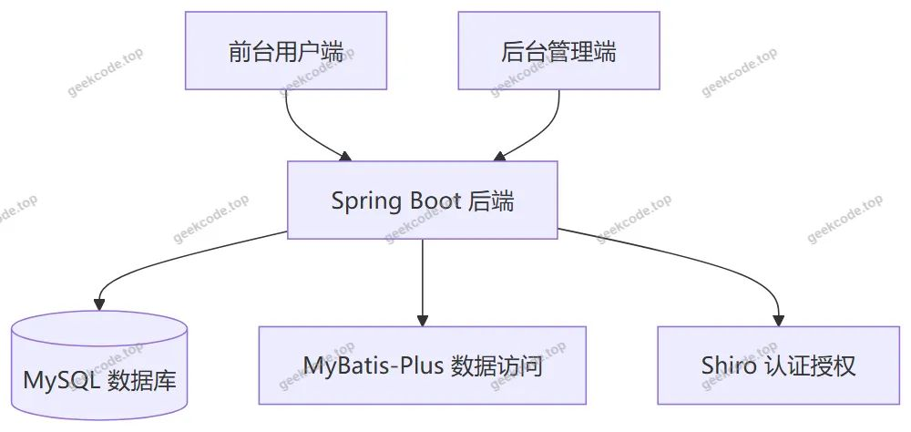</a>

数据库设计围绕时装购物业务展开，核心数据对象包括商品信息、商品分类、颜色、商品资讯、商品评论、商品评价、用户、购物车、订单、地址、收藏、客服聊天和系统配置。商品信息作为前台浏览和后台管理的核心内容，与分类、颜色、评论、评价、收藏、购物车、订单等模块存在业务关联。后台订单模块通过 <code>/orders/:status</code> 路由体现按状态管理订单的能力。

<h2>功能模块</h2>
<h3>前台用户端</h3>
<table>
<thead>
<tr>
<th>功能模块</th>
<th>主要能力</th>
</tr>
</thead>
<tbody><tr>
<td>首页与导航</td>
<td>提供前台入口，承载商品信息与商品资讯导航</td>
</tr>
<tr>
<td>登录与注册</td>
<td>提供用户身份认证入口，支持用户注册和登录</td>
</tr>
<tr>
<td>商品信息浏览</td>
<td>展示商品信息列表与商品信息详情</td>
</tr>
<tr>
<td>商品资讯浏览</td>
<td>展示商品资讯列表与商品资讯详情</td>
</tr>
<tr>
<td>商品分类浏览</td>
<td>展示商品分类列表与商品分类详情</td>
</tr>
<tr>
<td>颜色浏览</td>
<td>展示颜色列表与颜色详情</td>
</tr>
<tr>
<td>商品信息评论</td>
<td>展示商品信息评论列表与评论详情</td>
</tr>
<tr>
<td>商品评价</td>
<td>展示商品评价列表与评价详情</td>
</tr>
<tr>
<td>购物车</td>
<td>展示购物车列表</td>
</tr>
<tr>
<td>个人中心</td>
<td>提供用户个人信息入口</td>
</tr>
<tr>
<td>我的订单</td>
<td>展示用户订单列表</td>
</tr>
<tr>
<td>我的地址</td>
<td>展示用户地址列表，并支持地址信息维护</td>
</tr>
<tr>
<td>我的收藏</td>
<td>展示用户收藏列表，并支持收藏信息管理</td>
</tr>
<tr>
<td>客服聊天</td>
<td>提供客服聊天界面</td>
</tr>
</tbody></table>
<h3>后台管理端</h3>
<table>
<thead>
<tr>
<th>功能模块</th>
<th>主要能力</th>
</tr>
</thead>
<tbody><tr>
<td>后台登录页</td>
<td>管理员进入后台管理系统的认证入口</td>
</tr>
<tr>
<td>后台首页</td>
<td>后台管理系统的总览入口</td>
</tr>
<tr>
<td>商品资讯管理</td>
<td>管理 <code>/news</code> 对应的商品资讯内容</td>
</tr>
<tr>
<td>商品信息管理</td>
<td>管理 <code>/shangpinxinxi</code> 对应的商品信息</td>
</tr>
<tr>
<td>商品分类管理</td>
<td>管理 <code>/shangpinfenlei</code> 对应的商品分类</td>
</tr>
<tr>
<td>颜色管理</td>
<td>管理 <code>/yanse</code> 对应的颜色信息</td>
</tr>
<tr>
<td>商品评价管理</td>
<td>管理 <code>/shangpinpingjia</code> 对应的商品评价</td>
</tr>
<tr>
<td>商品信息评论管理</td>
<td>管理 <code>/discussshangpinxinxi</code> 对应的商品信息评论</td>
</tr>
<tr>
<td>用户管理</td>
<td>管理 <code>/yonghu</code> 对应的用户信息</td>
</tr>
<tr>
<td>订单管理</td>
<td>管理 <code>/orders/:status</code> 对应的订单信息，并按状态查看和管理订单</td>
</tr>
<tr>
<td>我的收藏管理</td>
<td>管理 <code>/storeup</code> 对应的收藏信息</td>
</tr>
<tr>
<td>系统配置管理</td>
<td>管理 <code>/config</code> 对应的系统配置</td>
</tr>
<tr>
<td>轮播图管理</td>
<td>管理后台轮播图内容</td>
</tr>
<tr>
<td>客服管理</td>
<td>管理 <code>/chat</code> 对应的客服聊天内容</td>
</tr>
</tbody></table>

后端控制器与主要业务模块对应关系如下：AddressController 对应地址模块，CartController 对应购物车模块，ChatController 对应客服聊天模块，CommonController 对应公共接口，ConfigController 对应系统配置模块，DiscussshangpinxinxiController 对应商品信息评论模块，FileController 对应文件处理能力，NewsController 对应商品资讯模块，OrdersController 对应订单模块，ShangpinfenleiController 对应商品分类模块，ShangpinpingjiaController 对应商品评价模块，ShangpinxinxiController 对应商品信息管理模块。

<h2>用户角色与权限</h2>

系统根据前台用户端和后台管理端划分两类主要使用角色：普通用户和管理员。

<table>
<thead>
<tr>
<th>角色</th>
<th>可访问功能模块</th>
</tr>
</thead>
<tbody><tr>
<td>普通用户</td>
<td>前台首页、登录、注册、商品信息浏览、商品资讯浏览、商品分类浏览、颜色浏览、商品信息评论查看、商品评价查看、购物车列表、个人中心、我的订单、我的地址、我的收藏、客服聊天</td>
</tr>
<tr>
<td>管理员</td>
<td>后台登录页、后台首页、商品资讯管理、商品信息管理、商品分类管理、颜色管理、商品评价管理、商品信息评论管理、用户管理、订单管理、我的收藏管理、系统配置管理、轮播图管理、客服管理</td>
</tr>
</tbody></table>

普通用户通过前台页面完成商品浏览、个人中心查看、订单查看、地址维护、收藏管理、购物车查看和客服聊天等操作。管理员通过后台管理端完成商品、资讯、分类、颜色、评价、评论、订单、用户、收藏、配置、轮播图和客服内容的管理操作。系统使用 Shiro 提供认证授权基础，用于区分不同访问入口和受保护资源。

<h2>项目特色与创新点</h2>

网页时装购物系统围绕时装商品展示、用户互动和后台统一管理构建，形成前台浏览与后台运营相结合的业务结构。前台以商品信息、商品资讯、商品分类、颜色、评论、评价、购物车、订单、地址、收藏、个人中心和客服聊天为核心入口，满足时装商品线上展示与用户自助查看需求。

后台以商品、订单、用户、资讯、分类、颜色、评论、评价、收藏、配置、轮播图和客服管理为重点，提供面向运营管理人员的统一维护能力。订单管理通过 <code>/orders/:status</code> 路由体现按状态组织订单信息的设计，便于后台对不同订单状态进行集中查看。

技术层面，项目采用 Spring Boot 构建后端服务，使用 MyBatis-Plus 简化数据访问，使用 Shiro 提供认证授权能力，并结合 vue-integrated 前端形态完成前台用户端与后台管理端的页面交互。系统还通过 FileController 提供文件相关处理能力，通过 CommonController 提供公共接口能力，为业务模块提供基础支撑。

<h2>部署环境</h2>
<table>
<thead>
<tr>
<th>环境组件</th>
<th>部署需求</th>
</tr>
</thead>
<tbody><tr>
<td>JDK</td>
<td>需要安装与项目源码和依赖配置匹配的 Java 运行环境，具体版本根据现有信息无法确定</td>
</tr>
<tr>
<td>MySQL</td>
<td>需要安装 MySQL 数据库，用于存储商品、用户、订单、资讯、分类、颜色、评论、评价、收藏、购物车、地址、聊天、配置等数据，具体版本根据现有信息无法确定</td>
</tr>
<tr>
<td>Node.js</td>
<td>由于项目类型为 vue-integrated，需要安装 Node.js 用于前端依赖安装与构建，具体版本根据现有信息无法确定</td>
</tr>
<tr>
<td>Web 浏览器</td>
<td>需要现代浏览器访问前台用户端和后台管理端页面</td>
</tr>
<tr>
<td>Spring Boot Web 运行环境</td>
<td>后端服务基于 spring-boot-starter-web 提供 Web 运行能力</td>
</tr>
<tr>
<td>数据库初始化环境</td>
<td>需要按项目实际配置准备数据库、表结构和必要数据，具体初始化脚本根据现有信息无法确定</td>
</tr>
<tr>
<td>Java 构建工具</td>
<td>若从源码构建，需要使用项目实际配置的 Java 构建工具，具体构建工具与版本根据现有信息无法确定</td>
</tr>
</tbody></table>
<h2>五、技术特性</h2>
<ul>
<li>前后端集成部署，前端资源打包至后端 static 目录</li>
<li>使用 MyBatis-Plus 简化数据访问层开发</li>
<li>集成 Shiro 权限框架实现角色权限控制</li>
</ul>
<h2>六、功能模块截图</h2>
<h3>前台用户端</h3>
<h4>前台首页</h4>

<h4>前台登录页</h4>

<h4>前台注册页</h4>

<h4>前台-商品资讯列表</h4>

<h4>前台-商品信息列表</h4>

<h4>前台-商品信息评论列表</h4>

<h4>前台个人中心</h4>

<h4>前台-我的地址列表</h4>

<h4>前台-我的订单列表</h4>

<h4>前台-我的收藏列表</h4>

<h4>前台-商品资讯-详情</h4>

<h4>前台-商品信息-详情</h4>

<a href="https://geekcode.top/archives/%E7%BD%91%E9%A1%B5%E6%97%B6%E8%A3%85%E8%B4%AD%E7%89%A9%E7%B3%BB%E7%BB%9F?utm_source=github" title="查看完整源码">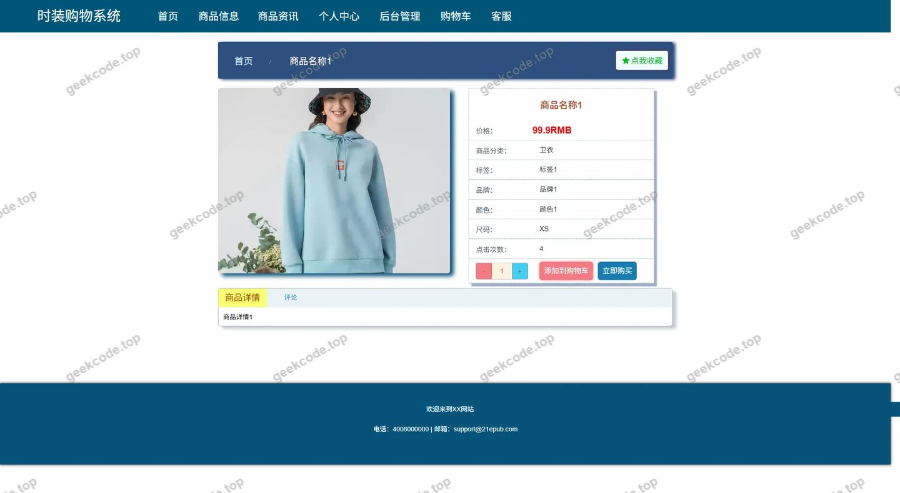</a>

<h4>前台-商品分类列表</h4>

<h4>前台-商品评价列表</h4>

<h4>前台-购物车列表</h4>

<h4>前台-颜色列表</h4>

<h4>前台-商品信息评论-详情</h4>

<a href="https://geekcode.top/archives/%E7%BD%91%E9%A1%B5%E6%97%B6%E8%A3%85%E8%B4%AD%E7%89%A9%E7%B3%BB%E7%BB%9F?utm_source=github" title="查看完整源码">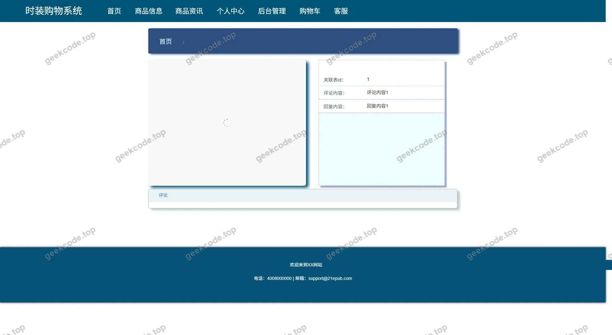</a>

<h4>前台-商品分类-详情</h4>

<a href="https://geekcode.top/archives/%E7%BD%91%E9%A1%B5%E6%97%B6%E8%A3%85%E8%B4%AD%E7%89%A9%E7%B3%BB%E7%BB%9F?utm_source=github" title="查看完整源码">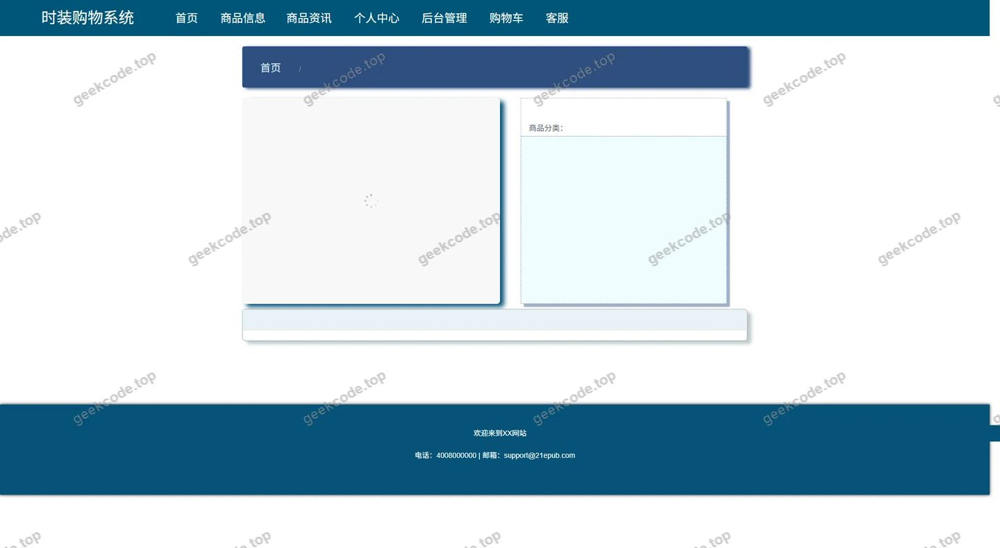</a>

<h4>前台-商品评价-详情</h4>

<a href="https://geekcode.top/archives/%E7%BD%91%E9%A1%B5%E6%97%B6%E8%A3%85%E8%B4%AD%E7%89%A9%E7%B3%BB%E7%BB%9F?utm_source=github" title="查看完整源码">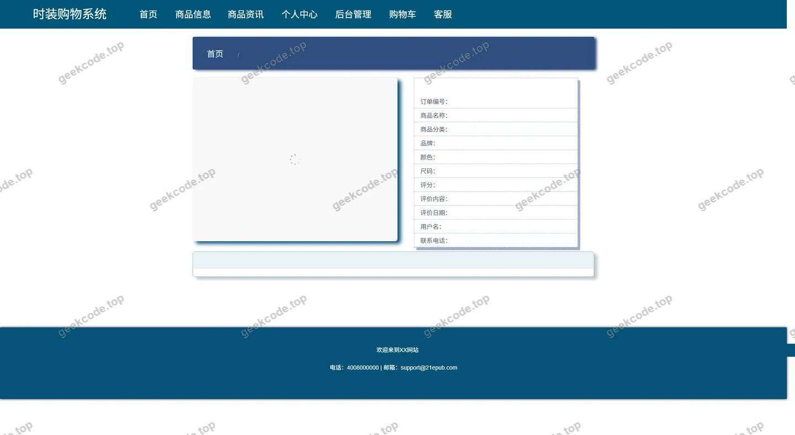</a>

<h4>前台-颜色-详情</h4>

<h4>前台-客服聊天</h4>

<h3>后台管理端</h3>
<h4>后台-在线客服</h4>

<a href="https://geekcode.top/archives/%E7%BD%91%E9%A1%B5%E6%97%B6%E8%A3%85%E8%B4%AD%E7%89%A9%E7%B3%BB%E7%BB%9F?utm_source=github" title="查看完整源码">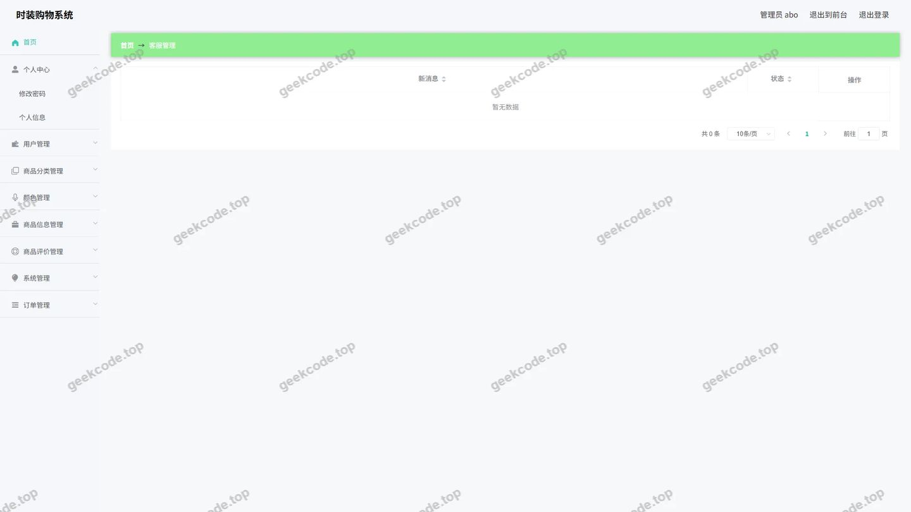</a>

<h4>后台-系统配置</h4>

<a href="https://geekcode.top/archives/%E7%BD%91%E9%A1%B5%E6%97%B6%E8%A3%85%E8%B4%AD%E7%89%A9%E7%B3%BB%E7%BB%9F?utm_source=github" title="查看完整源码">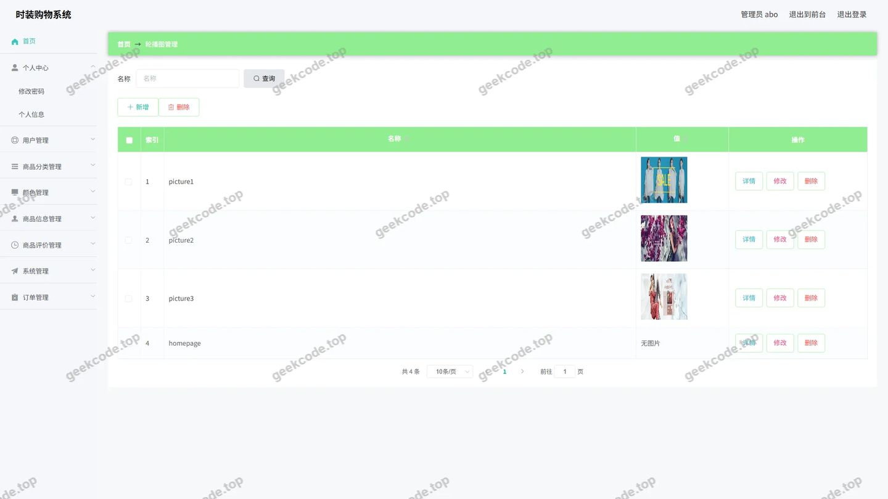</a>

<h4>后台-商品信息评论</h4>

<a href="https://geekcode.top/archives/%E7%BD%91%E9%A1%B5%E6%97%B6%E8%A3%85%E8%B4%AD%E7%89%A9%E7%B3%BB%E7%BB%9F?utm_source=github" title="查看完整源码">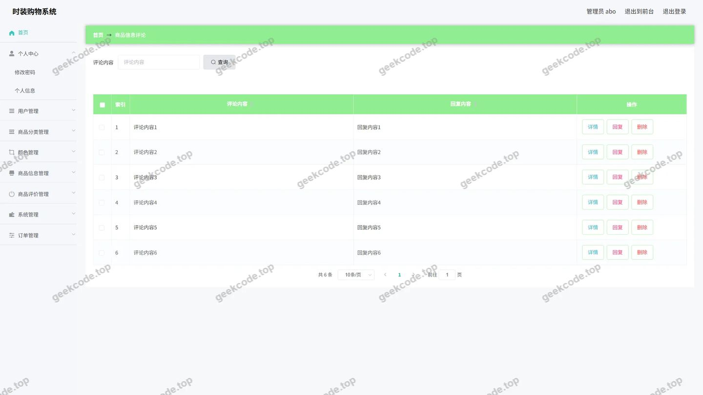</a>

<h4>后台首页</h4>

<a href="https://geekcode.top/archives/%E7%BD%91%E9%A1%B5%E6%97%B6%E8%A3%85%E8%B4%AD%E7%89%A9%E7%B3%BB%E7%BB%9F?utm_source=github" title="查看完整源码">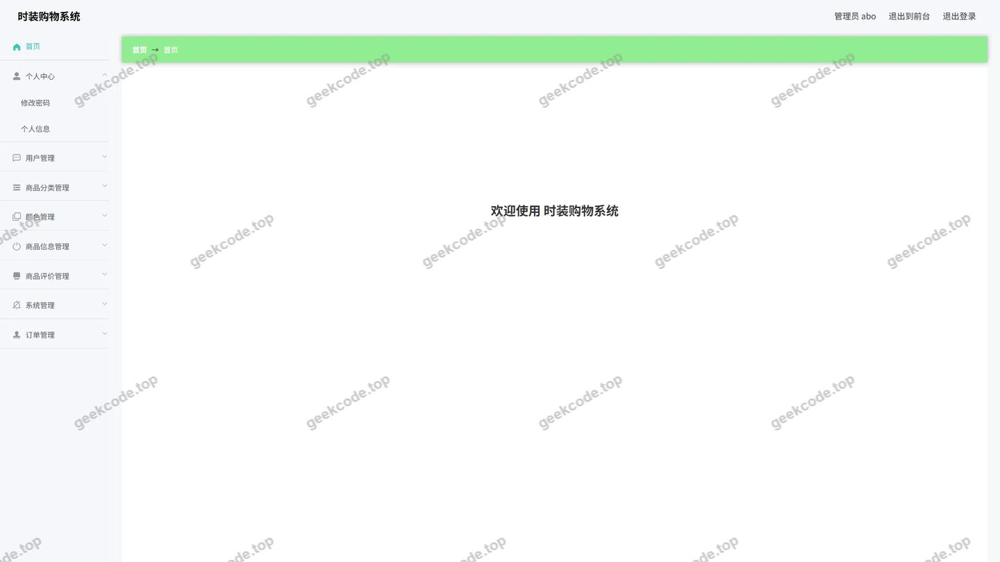</a>

<h4>后台-登录</h4>

<h4>后台-公告信息</h4>

<a href="https://geekcode.top/archives/%E7%BD%91%E9%A1%B5%E6%97%B6%E8%A3%85%E8%B4%AD%E7%89%A9%E7%B3%BB%E7%BB%9F?utm_source=github" title="查看完整源码">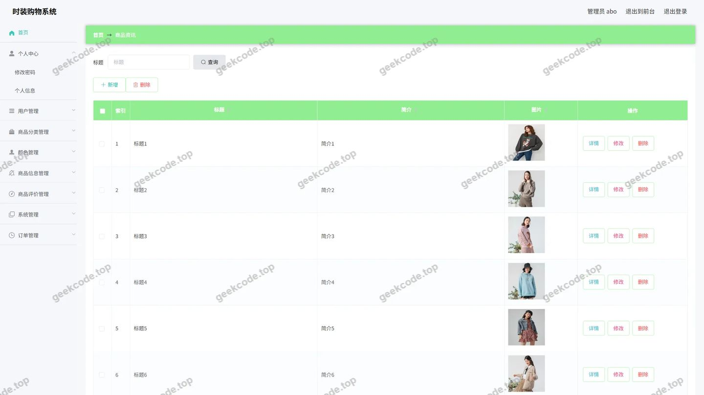</a>

<h4>后台-订单-状态</h4>

<a href="https://geekcode.top/archives/%E7%BD%91%E9%A1%B5%E6%97%B6%E8%A3%85%E8%B4%AD%E7%89%A9%E7%B3%BB%E7%BB%9F?utm_source=github" title="查看完整源码">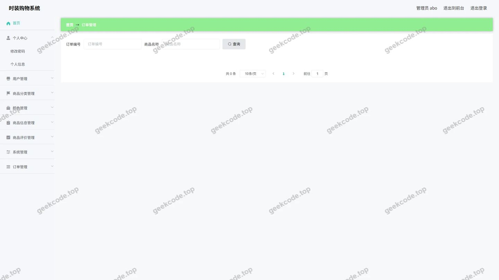</a>

<h4>后台-商品分类</h4>

<a href="https://geekcode.top/archives/%E7%BD%91%E9%A1%B5%E6%97%B6%E8%A3%85%E8%B4%AD%E7%89%A9%E7%B3%BB%E7%BB%9F?utm_source=github" title="查看完整源码">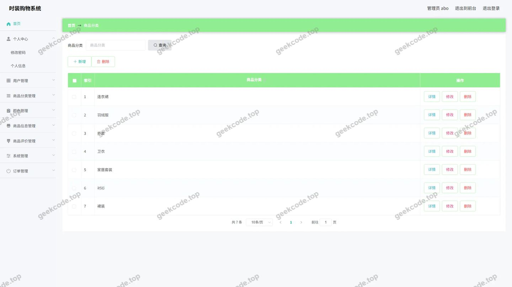</a>

<h4>后台-商品评价</h4>

<a href="https://geekcode.top/archives/%E7%BD%91%E9%A1%B5%E6%97%B6%E8%A3%85%E8%B4%AD%E7%89%A9%E7%B3%BB%E7%BB%9F?utm_source=github" title="查看完整源码">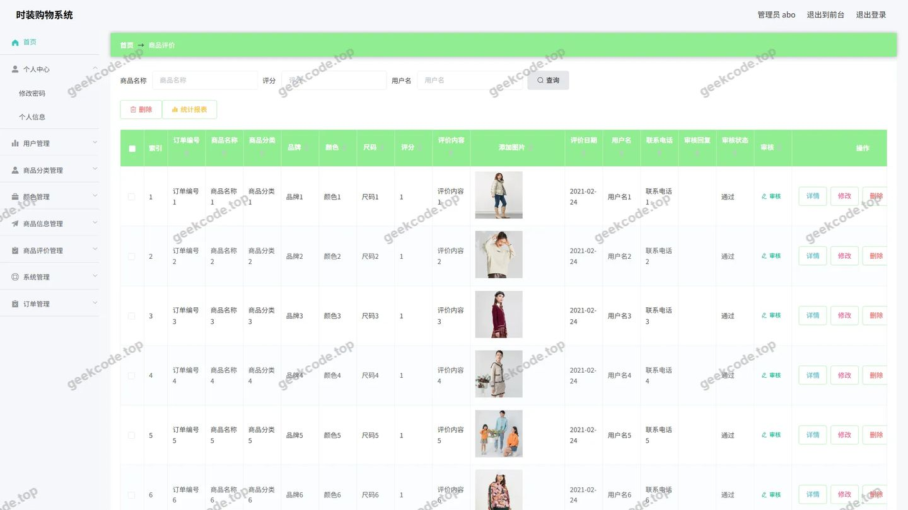</a>

<h4>后台-商品信息</h4>

<a href="https://geekcode.top/archives/%E7%BD%91%E9%A1%B5%E6%97%B6%E8%A3%85%E8%B4%AD%E7%89%A9%E7%B3%BB%E7%BB%9F?utm_source=github" title="查看完整源码">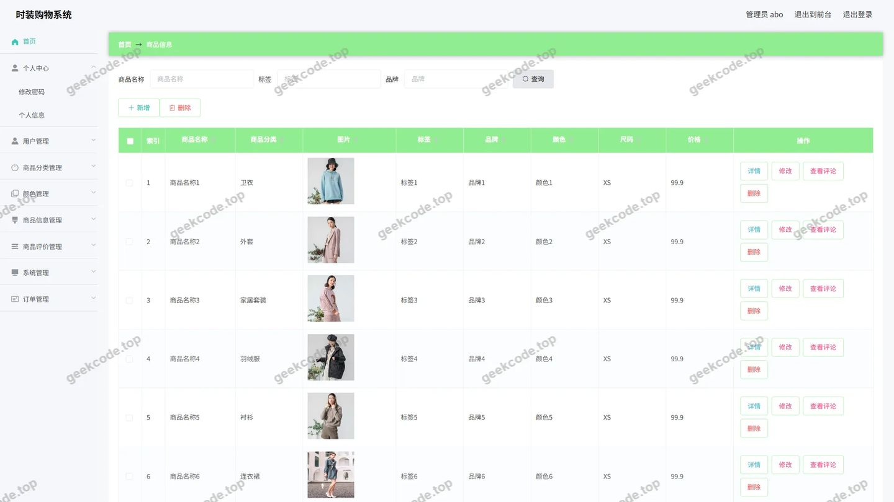</a>

<h4>后台-收藏</h4>

<a href="https://geekcode.top/archives/%E7%BD%91%E9%A1%B5%E6%97%B6%E8%A3%85%E8%B4%AD%E7%89%A9%E7%B3%BB%E7%BB%9F?utm_source=github" title="查看完整源码">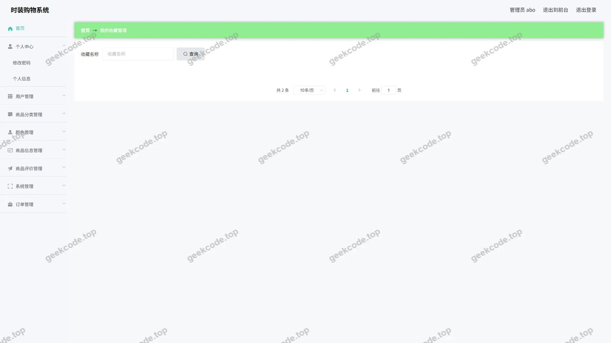</a>

<h4>后台-颜色</h4>

<a href="https://geekcode.top/archives/%E7%BD%91%E9%A1%B5%E6%97%B6%E8%A3%85%E8%B4%AD%E7%89%A9%E7%B3%BB%E7%BB%9F?utm_source=github" title="查看完整源码">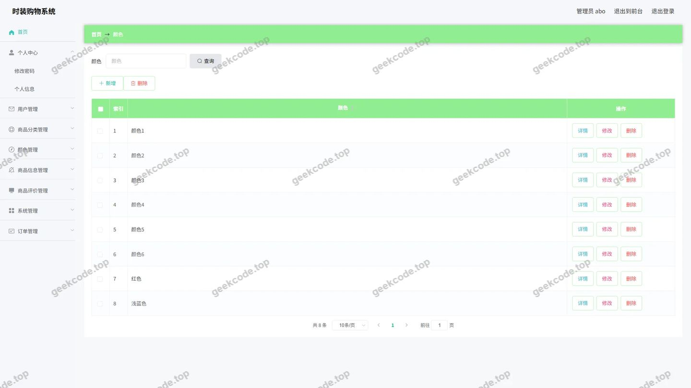</a>

---

## 获取完整源码

| 项目 | 说明 |
| --- | --- |
| 项目名 | 网页时装购物系统 |
| 运行截图 | 本文 34 张（站点带水印原图，仓库 `images/` 目录） |
| 完整源码 | [https://geekcode.top/archives/%E7%BD%91%E9%A1%B5%E6%97%B6%E8%A3%85%E8%B4%AD%E7%89%A9%E7%B3%BB%E7%BB%9F?utm_source=github](https://geekcode.top/archives/%E7%BD%91%E9%A1%B5%E6%97%B6%E8%A3%85%E8%B4%AD%E7%89%A9%E7%B3%BB%E7%BB%9F?utm_source=github) |
| 咨询微信 | **ir9372**（备注：jingpin-yuanma） |
| 更多项目 | [极客代码 geekcode.top](https://geekcode.top/?utm_source=github) |

> 需要源码、部署、改配置、跑不起来等问题，加微信 ir9372 沟通，说明项目名即可。
